<div align="center">


# Limvo

**Your AI plan limits in the Windows taskbar: Claude, Codex, Cursor and Antigravity, with the pace you are using them at.**

<a href="https://apps.microsoft.com/detail/9MZ7HN8V6GX5?mode=direct"></a>

[Download](#install) · [Features](#features) · [Services](#supported-services) · [How it works](#how-it-works) · [Setups](#setups-and-scenarios) · [Build from source](#build-from-source) · [Code signing policy](#code-signing-policy) · [Contributing](CONTRIBUTING.md)

</div>

---

Limvo puts the plan limits of the AI tools you use next to the clock. It tells
you how much of each allowance is gone, whether you are on track to make it to
the reset, and when a limit will run out at today's pace. It reads the same
numbers as each service's own usage page, refreshes them on its own while you
work, and nudges you with a Windows notification before you run out.

<p align="center">
  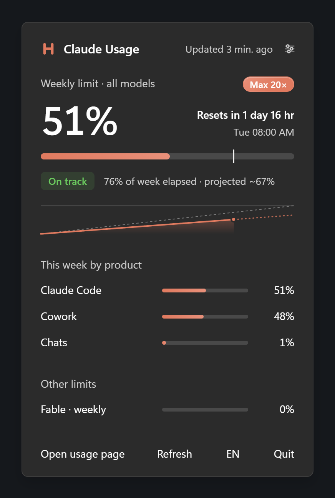
  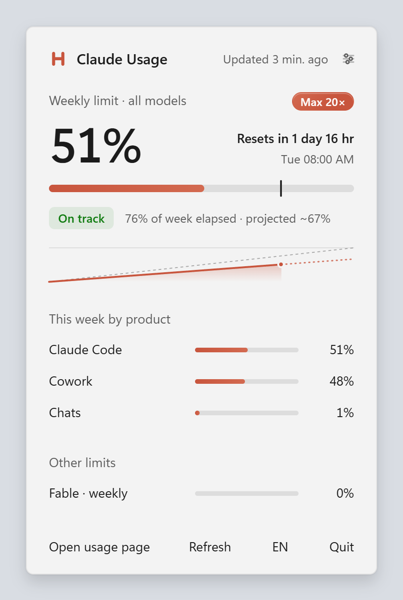
</p>

<p align="center">
  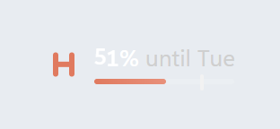
  &nbsp;
  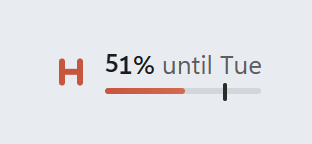
</p>

## Features

- **Every service in one place.** Claude, Codex (ChatGPT plans), Cursor and
  Google Antigravity each get a tab with their own logo, plan badge and
  colour. A service appears as soon as you are signed in to it on this
  computer; there is nothing to configure.

  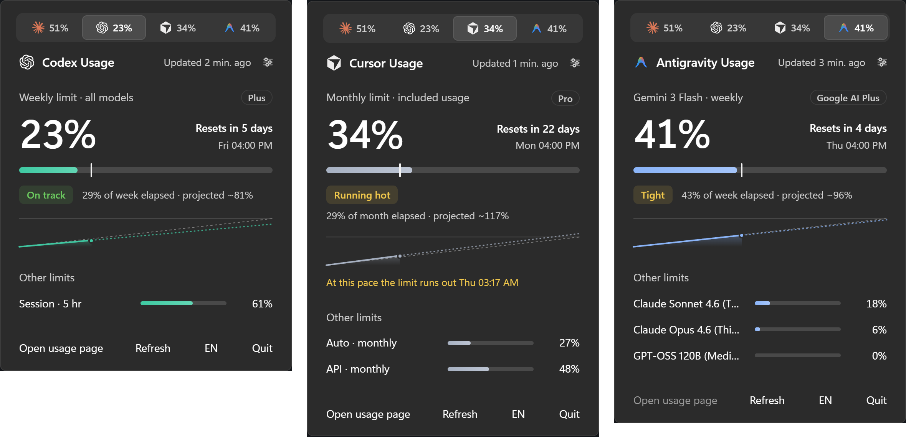

- **The taskbar shows what you choose.** One limit reads as a sentence,
  `51% until Tue`. Pin up to six limits from any services and they sit side
  by side as logo, number and meter. The reading appears on the taskbar of
  every monitor, and a click opens the flyout above the one you clicked.
- **A forecast, not just a reading.** A tick on each meter marks how much of
  the period has passed. Limvo projects your usage to the reset, labels it
  _On track_, _Tight_, _Running hot_ or _Limit reached_, charts the period
  against an even pace and says when the limit runs out at today's rate.

  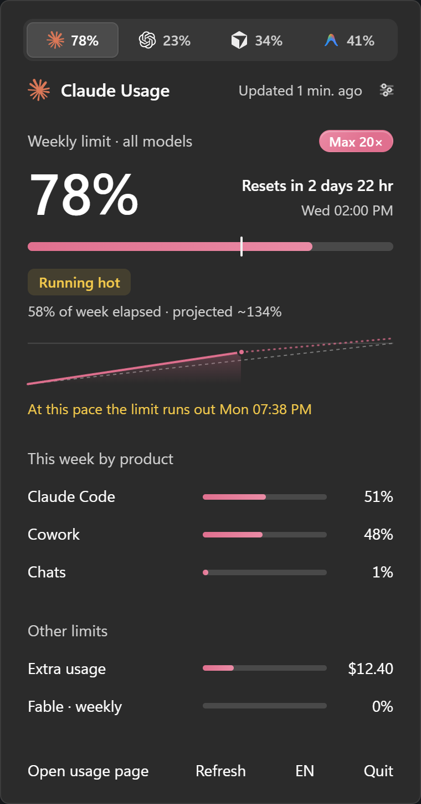

- **The whole picture per service.** Claude's weekly limit, its split between
  Claude Code, chats and Cowork, model caps and extra usage; Codex's weekly
  and five-hour windows; Cursor's monthly included usage with Auto and API;
  Antigravity's weekly quota for every agent model.
- **A counter with some craft.** The percentage rolls in on drum wheels like an
  old odometer: each digit drops in from above, and a wheel only moves on when
  the one to its right passes nine.

  

- **Live without polling all day.** While you work in Claude Code, Codex,
  Cursor or Antigravity the readings update about once a minute; when you are
  idle they slow down to every five minutes. Fixed intervals are one click
  away.
- **Windows notifications** at 80% and 95%, when a limit is reached and when a
  busy period resets, each naming its service.
- **Plan colours.** Limvo recognises the plan (Claude Free, Pro, Max 5×,
  Max 20×, Team and Enterprise; ChatGPT, Cursor and Google AI plans) and tints
  each service in its own colour. Status colours keep their meaning.
- **Settings that respect your taskbar.** Choose the pinned limits, turn the
  reading off on other monitors, pin a compact card to the desktop, change the
  language or the update frequency.

  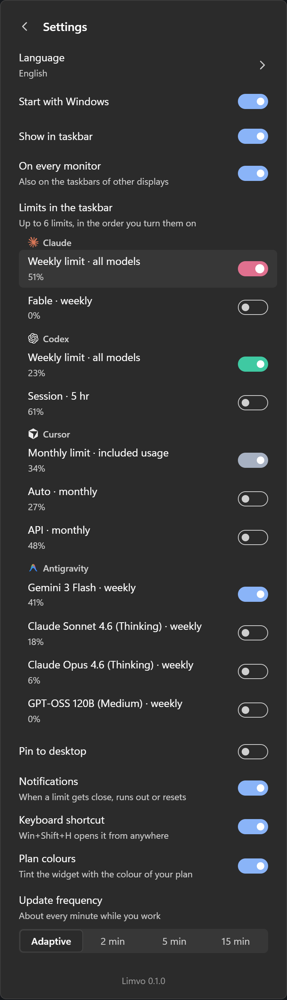
  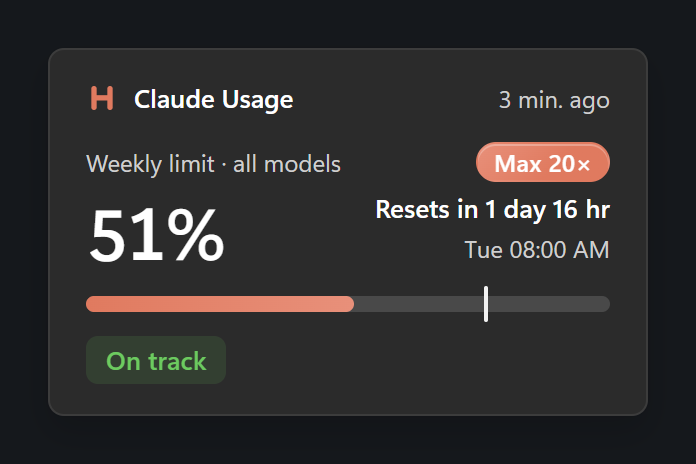

- **Keyboard shortcut.** Win+Shift+H opens the flyout from anywhere, or
  Ctrl+Alt+H when another app holds the first.
- **Native feel.** Mica material, Windows 11 motion and controls, light and
  dark themes (the strip follows the taskbar theme, the flyout follows the app
  theme), respects _Animation effects_ and high DPI.
- **Eleven languages**, including right-to-left Hebrew: English, Polski,
  Deutsch, Español, Français, Italiano, Português (Brasil), Українська, עברית,
  日本語 and 简体中文. Follows the Windows display language or your choice.

  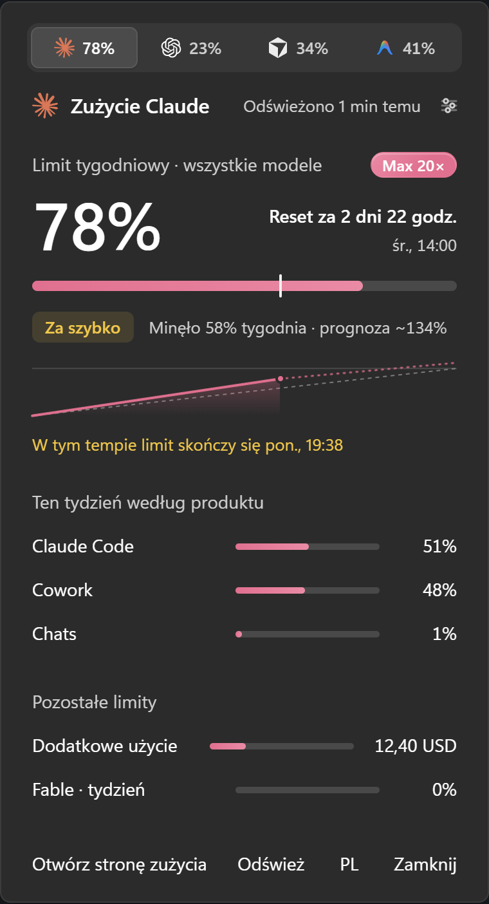
  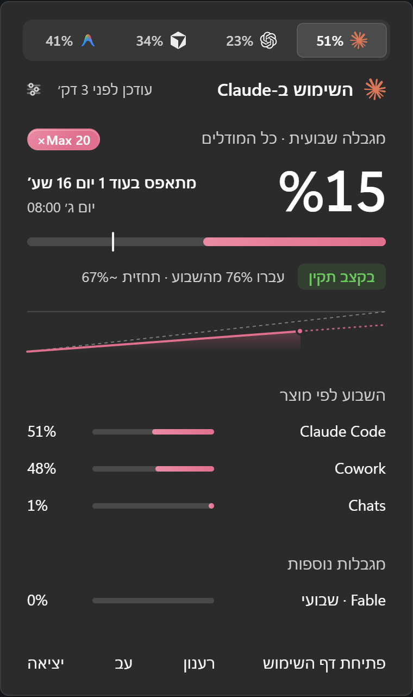

- **Small and private.** A few megabytes, no telemetry, no account, no server
  of its own. See [Privacy and security](#privacy-and-security).

## Supported services

| Service         | Plans                                        | Limits shown                                                               | Sign-in Limvo reads                           |
| --------------- | -------------------------------------------- | -------------------------------------------------------------------------- | --------------------------------------------- |
| **Claude**      | Free, Pro, Max 5×, Max 20×, Team, Enterprise | Weekly limit, split by product, model caps, five-hour session, extra usage | Claude desktop app, or Claude Code (`claude`) |
| **Codex**       | ChatGPT Plus, Pro, Business and others       | Weekly limit, five-hour session                                            | Codex CLI or app signed in with ChatGPT       |
| **Cursor**      | Free, Pro, Pro+, Ultra, Business             | Monthly included usage, Auto, API                                          | Cursor editor                                 |
| **Antigravity** | Free, Google AI plans                        | Weekly quota of each agent model                                           | Google Antigravity app                        |

Each service is a small module behind one interface. Adding another one is
described in [CONTRIBUTING.md](CONTRIBUTING.md#add-a-service).

## Install

### Microsoft Store (recommended)

<a href="https://apps.microsoft.com/detail/9MZ7HN8V6GX5?mode=direct"></a>

The Store package is signed by Microsoft, so there is no SmartScreen warning,
and the Store keeps it up to date. From a terminal:

```powershell
winget install --id 9MZ7HN8V6GX5 --source msstore
```

### Installer from GitHub

1. Download `Limvo_<version>_x64-setup.exe` from the
   [latest release](../../releases/latest).
2. Run it. It installs for your user only, so no administrator prompt.
   Choose your language on the first screen.

<p align="center">
  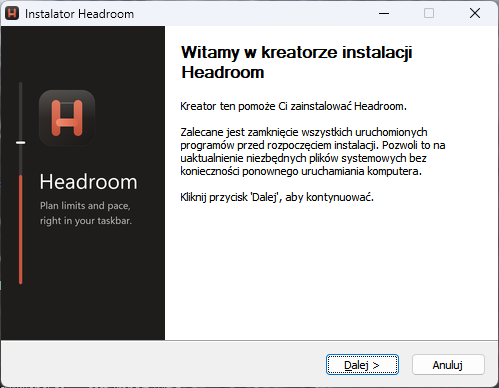
</p>

> **"Windows protected your PC"**
> The installer is not code-signed yet; free signing through SignPath
> Foundation is being set up (see the [code signing policy](#code-signing-policy)).
> Until then Microsoft SmartScreen shows this warning for new downloads.
> Choose **More info**, check that the file name matches the release, then
> **Run anyway**. You can verify the download with the SHA-256 checksum
> published next to each release, or install from the Microsoft Store instead.

### After installing

1. Limvo starts in the notification area and docks its reading in the
   taskbar. Sign in to at least one of the services (see
   [Setups](#setups-and-scenarios)).
2. Windows tucks new tray icons behind the `^` arrow. To keep the L next to the
   clock, drag it out of the overflow, or turn it on under _Settings >
   Personalization > Taskbar > Other system tray icons_.

**Updating:** the Store version updates through the Store. The installer
version checks GitHub twice a day and offers a newer version in the flyout; it
installs only when you choose _Update_ and only if it is signed with the
release key.

**One or the other:** both versions share their settings, and only one copy of
Limvo runs at a time. To switch, uninstall the one you have, then install the
other.

**Requirements:** Windows 10 version 2004 or later, or Windows 11, 64-bit. The
WebView2 runtime ships with Windows 11; on Windows 10 the installer fetches it
if it is missing.

**Uninstall:** _Settings > Apps > Installed apps > Limvo > Uninstall_. Your
preferences live in `%APPDATA%\io.github.michu1810.limvo` and can be deleted
afterwards.

## Using Limvo

| Where           | What it does                                                                                                                                                      |
| --------------- | ----------------------------------------------------------------------------------------------------------------------------------------------------------------- |
| Taskbar reading | Click to open or close the flyout above it. Hover to see every pinned limit by name.                                                                              |
| Tray icon       | Left click opens the flyout; right click offers _Refresh_ and _Quit_. The tooltip lists the pinned limits.                                                        |
| Flyout          | One tab per service (arrow keys switch). _Open usage page_ goes to the service's own page, _Refresh_ reads now, the sliders icon opens settings. `Esc` closes it. |
| Desktop card    | Drag it to move it; double click opens the flyout.                                                                                                                |

### Settings

| Setting            | Default  | Notes                                                                                            |
| ------------------ | -------- | ------------------------------------------------------------------------------------------------ |
| Language           | System   | Any of the eleven languages, or follow Windows.                                                  |
| Start with Windows | Off      | Adds Limvo to your user's startup apps.                                                          |
| Show in taskbar    | On       | Turn off to keep only the tray icon.                                                             |
| On every monitor   | On       | A reading on the taskbar of every display, not only the main one.                                |
| Limits in taskbar  | Main     | Each service's main limit, or up to six you pick, in the order you turn them on.                 |
| Pin to desktop     | Off      | Shows the desktop card. Its position is remembered.                                              |
| Notifications      | On       | 80%, 95%, limit reached, and the reset after a busy period. Each one is shown once per period.   |
| Keyboard shortcut  | On       | Win+Shift+H, or Ctrl+Alt+H when the first is taken. The panel shows which one is active.         |
| Plan colours       | On       | Tints each service with the colour of its plan.                                                  |
| Update frequency   | Adaptive | Adaptive follows activity in the services' own tools. 2, 5 or 15 minutes are fixed schedules.    |
| Check for updates  | On       | Installer version only: twice a day, against GitHub Releases; installs when you choose _Update_. |
| Extra accounts     | None     | Up to four more Claude Code or Codex accounts, each signed in from its own folder.               |

### Several accounts

A second Claude Code or Codex account lives in its own folder: sign in once
with that folder set (`CLAUDE_CONFIG_DIR` for Claude Code, `CODEX_HOME` for
Codex), then add it in _Settings > Extra accounts_. Pick the service, give it
a name such as _Work_, and choose the folder in the dialog. It gets its own
tab, its own limits in _Limits in the taskbar_, and a small letter beside the
service's mark wherever only the mark fits.

- An extra Claude account reads only the Claude Code sign-in in its folder,
  never the Claude desktop app, which stays with the main account.
- Removing an account only makes Limvo forget it. The folder and the sign-in
  stay as they are.
- Limvo refuses the main account's folder, a folder added twice and a folder
  with no sign-in in it.

## How it works

Limvo has no login of its own. It borrows the sign-in each service's own app
already keeps on your computer, asks the same endpoint that service uses to
draw its usage screen, and shows the answer.

| Service     | Sign-in                                                                                                                                                                             | Endpoint                                   |
| ----------- | ----------------------------------------------------------------------------------------------------------------------------------------------------------------------------------- | ------------------------------------------ |
| Claude      | The Claude desktop app's `config.json`, encrypted with Windows DPAPI for your account (classic `%APPDATA%\Claude` and Microsoft Store versions), then `~/.claude/.credentials.json` | `api.anthropic.com/api/oauth/usage`        |
| Codex       | `~/.codex/auth.json`, or `%CODEX_HOME%\auth.json`                                                                                                                                   | `chatgpt.com/backend-api/wham/usage`       |
| Cursor      | The editor's settings database, `%APPDATA%\Cursor\User\globalStorage\state.vscdb`, opened read-only                                                                                 | `api2.cursor.sh` dashboard service         |
| Antigravity | The Windows Credential Manager entry the app creates, `gemini:antigravity`                                                                                                          | `cloudcode-pa.googleapis.com` model quotas |

**Read only, always.** Limvo never refreshes, writes, moves or copies a
credential. A token is held in memory for one request and dropped. An expired
sign-in is reported as _sign in again_ instead of being renewed behind your
back, so Limvo can never sign you out of a service. Opening the service's own
app renews it.

**Adaptive updates.** None of these endpoints can push changes, so Limvo
watches the folders the services' tools write to while you use them
(`~/.claude/projects`, `~/.codex/sessions`, Cursor's workspace storage and
`~/.gemini/antigravity/conversations`). It only notices that files changed;
it never opens them. A change means you are working, so the next reading
comes within a minute. Requests go out one at a time, manual refreshes closer
than ten seconds apart reuse the last answer, and rate limits from the server
are honoured. One service failing never delays or blanks another.

> **These endpoints are undocumented.** Their owners can change them at any
> time. Limvo tolerates missing and new fields, keeps showing the last good
> reading when a refresh fails, and says so in the flyout, but a larger change
> on the server side may need an update of the app.

## Setups and scenarios

| Your setup                              | What happens                                                                                                                  |
| --------------------------------------- | ----------------------------------------------------------------------------------------------------------------------------- |
| Claude desktop app, signed in           | Works out of the box, including the Microsoft Store version.                                                                  |
| Claude Code CLI only                    | Works if you have signed in with `claude` at least once. Run `claude` and `/login` if the flyout says your sign-in expired.   |
| Codex CLI or app signed in with ChatGPT | A Codex tab appears. API-key sign-ins have no plan limits and are not shown.                                                  |
| Cursor signed in                        | A Cursor tab appears with the billing cycle's included usage.                                                                 |
| Antigravity signed in                   | An Antigravity tab appears. Its sign-in lasts an hour; open Antigravity now and then and Limvo picks up the renewed one.      |
| Only some services                      | Only those get a tab. With a single service, the tabs disappear and the flyout looks like a dedicated widget.                 |
| Signed out everywhere                   | The flyout asks you to sign in. Limvo checks again every two minutes, no restart needed.                                      |
| Custom tool folders                     | `CLAUDE_CONFIG_DIR` and `CODEX_HOME` are honoured the same way the CLIs honour them.                                          |
| Two Claude Code or Codex accounts       | Add the second one's folder in _Settings > Extra accounts_. See [Several accounts](#several-accounts).                        |
| Several monitors                        | Each taskbar gets a reading (turn off _On every monitor_ to keep only the main one). Flyout and card open where you use them. |
| Auto-hide taskbar                       | The reading hides with the taskbar and returns with it.                                                                       |
| Full-screen game, video or presentation | The reading steps aside on that monitor only. Live wallpapers and full-screen windows on other monitors do not hide it.       |
| Vertical taskbar (Windows 10)           | The taskbar reading is not shown; tray icon, flyout and card work.                                                            |
| Windows 10                              | No Mica, so the flyout uses a solid surface. Everything else is the same.                                                     |

## Privacy and security

- No telemetry, analytics or crash reporting. The only network requests are
  the usage requests to the services you are signed in to, each with its own
  token, over HTTPS, and the update check described below.
- Updates: the Store version has no update check of its own; the Store
  delivers its updates. The installer version reads, twice a day,
  `latest.json` of the newest release on GitHub (`github.com`, which serves the file from
  `objects.githubusercontent.com`). The request carries no token and no data
  about you. An update downloads only when you choose _Update_, and installs
  only if its signature matches the public key built into Limvo. Turn it off
  in _Settings > Check for updates_.
- Tokens stay in memory for the duration of one request and are never logged,
  stored or shown. Logs record only which source was used and HTTP status
  codes.
- Everything that touches credentials, the network and the system lives in the
  Rust core (`src-tauri/src`). The interface runs with a strict content
  security policy and can only call the commands listed in
  [`src-tauri/src/commands.rs`](src-tauri/src/commands.rs).
- Logs: `%LOCALAPPDATA%\io.github.michu1810.limvo\logs`. Settings:
  `%APPDATA%\io.github.michu1810.limvo\settings.json`.

Found a security problem? Please follow [SECURITY.md](SECURITY.md) instead of
opening a public issue.

## Code signing policy

Free code signing provided by [SignPath.io](https://signpath.io), certificate
by [SignPath Foundation](https://signpath.org). Signing starts with the first
release after the project is approved; earlier releases stay unsigned.

- Only installers built by the
  [Release workflow](.github/workflows/release.yml) from a tag in this
  repository are signed, the app inside them included. Nothing built on a
  personal machine is ever submitted.
- Committers and reviewers: [@michu1810](https://github.com/michu1810).
- Approvers: [@michu1810](https://github.com/michu1810). Each signing request
  is approved by hand.
- Privacy policy: Limvo sends no data anywhere except the usage requests to
  the services you are signed in to and the update check, as described in
  [Privacy and security](#privacy-and-security).

Details for maintainers are in [docs/CODE-SIGNING.md](docs/CODE-SIGNING.md).

## Troubleshooting

| Symptom                        | Try this                                                                                         |
| ------------------------------ | ------------------------------------------------------------------------------------------------ |
| A service has no tab           | Sign in to that service's own app on this computer. Limvo checks again every two minutes.        |
| _Your ... sign-in expired_     | Open that service's app (or run `claude` / `codex`); they renew the sign-in themselves.          |
| _Offline. Last reading ..._    | No connection to the service, or it asked to slow down. Limvo retries with back-off.             |
| The taskbar reading is missing | Check _Settings > Show in taskbar_, a full-screen window on that monitor, or a vertical taskbar. |
| Numbers look stale             | _Refresh_ in the flyout. Adaptive mode slows down after five idle minutes.                       |
| Something else                 | Attach the newest file from the logs folder to an issue. It contains no tokens.                  |

## Build from source

You need:

- [Node.js](https://nodejs.org) 22 or later
- [Rust](https://rustup.rs) (stable, 1.95 or later)
- Visual Studio Build Tools with the _Desktop development with C++_ workload
- WebView2 (preinstalled on Windows 11)

```powershell
winget install Rustlang.Rustup
winget install Microsoft.VisualStudio.2022.BuildTools --override "--quiet --add Microsoft.VisualStudio.Workload.VCTools --includeRecommended"
```

Then:

```powershell
npm install
npm run tauri dev      # the app with hot reload
npm run dev            # only the interface, in a browser, with sample data
npm run check          # types, lint and unit tests
cd src-tauri; cargo test; cargo clippy --all-targets
npm run tauri build    # installer in src-tauri/target/release/bundle/nsis
```

`npm run tauri build` also signs the update package, so it needs an updater
key. Without the release key, make a local one and point the build at it. The
installer works as usual and still accepts official updates; only the update
package next to it carries your local signature, and nothing reads that:

```powershell
npx tauri signer generate -w "$env:USERPROFILE\.tauri\limvo-local.key"
$env:TAURI_SIGNING_PRIVATE_KEY = Get-Content "$env:USERPROFILE\.tauri\limvo-local.key" -Raw
$env:TAURI_SIGNING_PRIVATE_KEY_PASSWORD = "<the password you chose, or empty>"
npm run tauri build
```

`npm run dev` serves the interface with built-in scenarios, which is the
quickest way to work on design: `?scenario=reference|fresh|tight|hot|reached|offline|auth|signedOut|error`,
`&more` for all four services, `&codex=off`, `&pins=claude:weekly_all,codex:session`,
`&locale=he`, `&theme=dark`, and `&now=<ISO time>` for reproducible screenshots.
Open `/strip.html` and `/card.html` for the other windows.

### Service logos

The logos in [`public/brand`](public/brand) come from each owner's brand or
press page. They are trademarks of their owners, are used only to show which
service a reading belongs to, and are not covered by the MIT license (see
[public/brand/README.md](public/brand/README.md)). A file named
`<id>-dark.svg` is used on dark surfaces. Delete a file to see the Limvo mark
in its place.

| File                            | Logo        | Official source                                                |
| ------------------------------- | ----------- | -------------------------------------------------------------- |
| `claude.svg`                    | Claude      | [anthropic.com/press-kit](https://www.anthropic.com/press-kit) |
| `codex.svg`, `codex-dark.svg`   | OpenAI      | [openai.com/brand](https://openai.com/brand/)                  |
| `cursor.svg`, `cursor-dark.svg` | Cursor cube | [cursor.com/brand](https://cursor.com/brand)                   |
| `antigravity.svg`               | Antigravity | [antigravity.google/press](https://antigravity.google/press)   |

## Project layout

```
src/                 Interface (React 19, TypeScript)
  core/              Pure logic: pace, alerts, pins, the shared data model
  i18n/              Translations and Intl formatting
  ui/                Flyout, taskbar strip, desktop card, controls
src-tauri/src/       Core (Rust, Tauri 2)
  providers/         One module per service: claude, codex, cursor, antigravity
  poller.rs          One slot per service: schedule, back-off, adaptive refresh
  taskbar.rs         A reading on every taskbar, next to the notification area
  flyout.rs card.rs  Window placement and behaviour
fixtures/            Shared contract fixtures and anonymised API answers
docs/                Architecture notes, code signing and images
```

Read [docs/ARCHITECTURE.md](docs/ARCHITECTURE.md) for the design, and
[CONTRIBUTING.md](CONTRIBUTING.md) to add a language or another service.

## Roadmap

- macOS menu bar version
- Code-signed GitHub installers through SignPath Foundation
- A Windows 11 Widgets board card (needs a widget provider in the MSIX package)

## Disclaimer

Limvo is an independent open-source project. It is not affiliated with,
endorsed by or sponsored by Anthropic, OpenAI, Anysphere (Cursor) or Google.
Claude, ChatGPT, Codex, Cursor and Antigravity are trademarks of their
respective owners, used here only to describe what the app works with.

## License

[MIT](LICENSE). The service logos in `public/brand` are excluded; see above.
